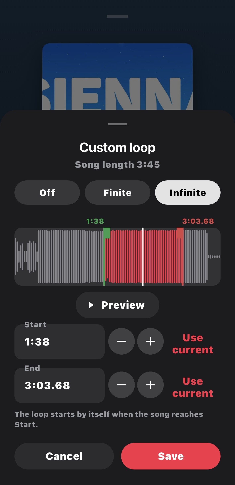
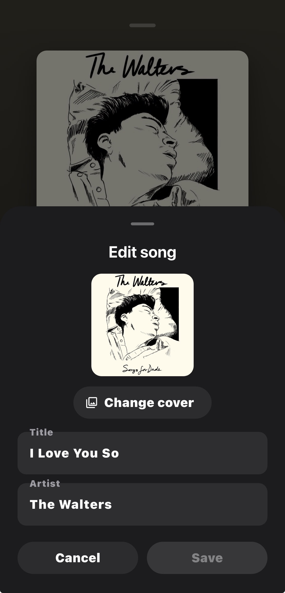

# KŌDA

### A Personal iOS Audio Player with Custom Section Looping

KŌDA is a Flutter-based iOS application built around a focused playback concept: allowing users to repeat precisely defined sections of an audio track rather than being limited to repeating an entire song.

The project explores custom audio playback logic, waveform-based editing, persistent track-specific configurations, and background audio integration within a structured mobile application architecture.

---

## Overview

Conventional audio players primarily provide whole-track repetition. KŌDA extends this concept by introducing customizable section looping, allowing playback to repeat a selected portion of an audio track for a finite number of times or indefinitely.

The application was developed as a personal software engineering project, with an emphasis on playback state management, audio handling, data persistence, and interface design.

## Key Features

- **Custom Section Looping:** Define specific start and end points within an audio track.
- **Finite Looping:** Repeat a selected section for a configured number of plays before continuing playback.
- **Infinite Looping:** Continuously repeat a selected section until an explicit user action exits the loop.
- **Whole-Track Repetition:** Supports repeat-once and repeat-infinite playback modes.
- **Waveform Visualization:** Generate and cache audio waveform data for visual section selection.
- **Interactive Loop Editor:** Adjust loop boundaries using draggable handles and fine-grained time adjustments.
- **Loop Preview:** Preview selected audio sections before saving configurations.
- **Per-Track Loop Profiles:** Persist individual loop configurations for each track.
- **Background Playback:** Integrate playback with iOS background audio and system media controls.
- **Playback Persistence:** Restore the previous playback session and retain relevant preferences.
- **Music Library Management:** Support local audio imports, metadata extraction, playlists, favorites, search, and recently played tracks.
- **Queue Management:** Manage playback order and shuffle behaviour.

## Technical Architecture

KŌDA follows a layered architecture that separates presentation, application state, business logic, and data management.

| Layer | Responsibilities |
|---|---|
| Presentation | Screens, widgets, waveform editor, and user interactions |
| State Management | Shared application state and reactive updates |
| Domain | Section-loop engine, playback logic, queue management, and waveform processing |
| Data | Repositories, database access, models, and persistence services |
| Core | Shared utilities, storage paths, and common functionality |

The audio handler coordinates playback operations and communicates with the presentation layer through application state and audio-service streams.

## Technology Stack

| Technology | Application |
|---|---|
| Flutter | Application framework |
| Dart | Primary programming language |
| Riverpod | State management |
| just_audio | Audio playback engine |
| audio_service | Background playback and system media controls |
| audio_session | Audio session configuration and interruption handling |
| SQLite / sqflite | Local database management |
| shared_preferences | Playback and preference persistence |
| just_waveform | Waveform generation |
| audio_metadata_reader | Audio metadata extraction |
| file_picker | Local audio file selection |
| image_picker | Artwork selection |
| Xcode | iOS development and debugging |
| Git & GitHub | Version control |

## Engineering Highlights

**Custom Audio Playback Engine**

Implemented a dedicated section-loop engine that processes playback position updates and manages loop boundaries, repeat counts, and loop-session transitions independently of the UI.

**Playback State Management**

Handled transitions between whole-track repetition, finite section looping, and infinite section looping while accounting for track changes and playback interruptions.

**Persistent Data Architecture**

Designed a local SQLite database with separate data models, data-access objects, and repositories for songs, playlists, and loop profiles.

**Waveform-Based Interaction**

Integrated waveform generation and caching with an interactive editor supporting adjustable loop boundaries and preview functionality.

**Background Audio Integration**

Integrated audio playback with iOS background execution and system media controls, including lock-screen and Control Centre interactions.

**Automated Testing**

Developed unit and widget tests covering loop logic, playback state, persistence, queue management, waveform components, and UI behaviour.

## Project Structure

```text
lib/
├── core/
├── data/
│   ├── database/
│   ├── models/
│   ├── repositories/
│   └── services/
├── domain/
│   ├── library/
│   ├── loop/
│   ├── playback/
│   └── waveform/
├── presentation/
│   ├── library/
│   ├── now_playing/
│   ├── playlists/
│   ├── queue/
│   ├── shared/
│   └── theme/
├── providers/
└── main.dart

test/
```

## Application Screenshots

Selected interface screens and implementation snapshots.

## Application Screenshots

<p align="center">
  
  
</p>

<p align="center">
  
  
</p>

<p align="center">
  
</p>

---

## Project Information

**Project:** KŌDA  
**Platform:** iOS  
**Framework:** Flutter  
**Language:** Dart  
**Development:** Personal Project

This repository is published as a technical portfolio and source-code showcase.

It is intended for source-code inspection and portfolio evaluation. No application installation instructions, setup guide, or end-user distribution guidance are provided.

**Licensing:** No open-source licence is granted with this repository. All rights remain reserved by the author, subject to the permissions required by GitHub for hosting and displaying public repositories.